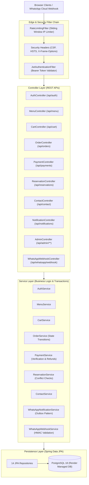

# Kaveri Restaurant — System Architecture & Technical Audit

**Audit Date**: October 21, 2026  
**Auditor**: Senior Full-Stack Architect, Backend Engineer & Application Security Reviewer  
**Repository**: [Anirudh07-07/restaurant](https://github.com/Anirudh07-07/restaurant) (`client/kaveri`)  
**Production Host**: Render Web Service (`srv-dbc2731srm7s739d64o0`) + Managed PostgreSQL 18 (`kaveridb`)  
**Live Production URL**: [https://kaveri-restaurant.onrender.com](https://kaveri-restaurant.onrender.com)

---

## 1. System Overview & Deployment Verification

### 1.1 Source of Truth & Repository Structure
The authoritative application source code resides in `foodnest/`, configured as a standard Spring Boot 3 multi-tiered enterprise monolith. 
- **Workspace Directory**: `/Users/anirudhsingh/Downloads/programing/res/foodnest`
- **Active Git Branch**: `client/kaveri`
- **Remote**: `https://github.com/Anirudh07-07/restaurant.git`
- **Deployment Coupling**: Render builds directly from GitHub repository `Anirudh07-07/restaurant` on branch `client/kaveri` using the root `Dockerfile` and `render.yaml` Infrastructure-as-Code Blueprint.
- **Verification**: Verified via curl that live production endpoint `https://kaveri-restaurant.onrender.com/actuator/health` and `/api/menu` correspond directly to the database seeded by `DataSeeder.java` in this repository.

### 1.2 Technology Stack
- **Language & Runtime**: Java 21 LTS (OpenJDK 21.0.12)
- **Framework**: Spring Boot 3.3.4 (Spring Framework 6.1.13)
- **Data Persistence**: Spring Data JPA / Hibernate 6.5.3 ORM
- **Database Support**:
  - **Production**: Managed PostgreSQL 18 (via Render Blueprint)
  - **Development**: MySQL 8.0+ or PostgreSQL
  - **Testing**: H2 In-Memory Database (MySQL compatibility mode)
- **Security & Cryptography**: Spring Security 6, JJWT (io.jsonwebtoken 0.12.5, HMAC-SHA256), Sliding Window In-Memory Rate Limiting
- **External Integrations**:
  - Razorpay Payment Gateway (Java SDK 1.4.3 + Webhooks)
  - Meta WhatsApp Business Platform Cloud API (Graph API v20.0)
- **Frontend Architecture**: Server-delivered static single/multi-page assets (HTML5, Bootstrap 5.3.2, FontAwesome 6.5.1, Vanilla JS ES6+ modules)

---

## 2. Architecture & Layered Structure

---

## 3. Backend Inventory

### 3.1 REST Controllers & API Endpoints

| Controller | Base Route | Key Operations | Auth Requirement |
| :--- | :--- | :--- | :--- |
| `AuthController` | `/api/auth` | Register, Login, Current User | Public (`/login`, `/register`) |
| `MenuController` | `/api/menu` | List (paginated), Detail, Search, Category Filter | Public (GET) |
| `CategoryController` | `/api/categories` | List all active categories | Public (GET) |
| `CartController` | `/api/cart` | View cart, Add item, Update qty, Clear | `CUSTOMER`, `ADMIN` |
| `OrderController` | `/api/orders` | Checkout create, Order history, Cancel, Detail | `CUSTOMER`, `ADMIN` |
| `PaymentController` | `/api/payments` | Create Razorpay order, Verify signature, Webhook callback | Webhook (Public), Orders (Authenticated) |
| `ReservationController` | `/api/reservations` | Book table, List user bookings, Cancel booking | `CUSTOMER`, `ADMIN` |
| `ContactController` | `/api/contact` | Submit inquiry form | Public (POST) |
| `ReviewController` | `/api/reviews` | List food/restaurant reviews, Create, Moderate | Public (GET), Auth (POST) |
| `NotificationController` | `/api/notifications` | User notifications, Unread count, Mark read | `CUSTOMER`, `ADMIN` |
| `WhatsAppWebhookController` | `/api/whatsapp/webhook` | Meta verification challenge (GET), Event notification handler (POST) | Public (HMAC Verified) |
| `AdminController` | `/api/admin` | Metrics, Orders, Menu CRUD, Users, Reviews, Inquiries | `ROLE_ADMIN` strictly enforced |

### 3.2 Database Entities & Relationships

| Entity | Table Name | Purpose & Keys | Notes |
| :--- | :--- | :--- | :--- |
| `User` | `users` | Customer & Admin identities; Unique `email` | Plural name avoids SQL keyword conflict |
| `Role` | `roles` | `ROLE_CUSTOMER`, `ROLE_ADMIN` | Pre-seeded on startup |
| `FoodItem` | `food_items` | Dishes with price, availability, veg/spicy flags | Indexed on category, name, available |
| `Category` | `categories` | Menu groupings | 15 categories pre-seeded |
| `Cart` | `carts` | 1:1 mapped to `User` | Auto-created on user registration |
| `CartItem` | `cart_items` | Items currently in user cart | Unit price and subtotal tracking |
| `Order` | `orders` | Customer order, status, total, delivery address | Includes `@Version` optimistic locking & `maker` assignment |
| `OrderItem` | `order_items` | Immutable snapshots of ordered dishes | Decoupled from food item price updates |
| `Payment` | `payments` | Razorpay payment records, statuses, txn IDs | Unique `razorpay_order_id` index |
| `Reservation` | `reservations` | Dining table bookings with date, time, guest count | Maximum 10 simultaneous slot capacity limit |
| `ContactMessage` | `contact_messages` | Customer inquiries and catering requests | Admin-reviewed with `is_read` flag |
| `Review` | `reviews` | Dish or restaurant rating (1-5) and feedback | Foreign key to user and optional food item |
| `Notification` | `notifications` | In-app user alerts | User FK with read tracking |
| `WhatsAppNotificationLog` | `whatsapp_notification_logs` | Transactional outbox for reliable delivery | Provider message IDs, retry count, status tracking |
| `WhatsAppWebhookEvent` | `whatsapp_webhook_events` | Idempotency deduplication for incoming webhooks | Unique `message_id` constraint prevents duplicate processing |

---

## 4. Frontend Inventory & Asset Mapping

The frontend consists of 32 standalone HTML pages backed by modular CSS and JavaScript:

### 4.1 Customer Storefront Pages
- **Home (`index.html`)**: Brand showcase, history, interactive hero slideshow, featured delicacies, reservation teaser, testimonials.
- **Digital Menu (`menu.html`)**: Dual-mode browsing (Classic Restaurant View & Visual Food Cards), live debounced search, category pill filter, modal details.
- **Cart (`cart.html`)**: Live cart items, quantity manipulation, subtotal, GST (5%), delivery charge logic (Free above ₹500), checkout trigger.
- **Checkout (`checkout.html`)**: Address collection, delivery vs pickup selector, payment choice (Razorpay Online vs Cash on Delivery), order placement.
- **Order History (`orders.html`)**: Customer order timeline, item breakdown, live order tracking statuses.
- **Reservations (`reservations.html`)**: Table booking form with date/time selectors, party size limits, and user reservation tracking.
- **Contact & Locations (`contact.html`)**: Flagship restaurant location, phone/email directory, interactive inquiry form.
- **Ventures & Heritage**: `about.html`, `catering.html`, `kaveris.html`, `punjab_sweet_house.html`, `capitol_hotels.html`, `the_kavs.html`, `gallery.html`.

### 4.2 Administrative Kitchen Management Suite
- **Dashboard (`admin/dashboard.html`)**: Real-time sales, order stats, pending bookings, unread messages.
- **Orders Console (`admin/orders.html`)**: Kitchen order queue, 1-click status transitions, WhatsApp sync badges, auto-refresh polling.
- **Menu Management (`admin/menu.html`)**: Dish creation, price updates, image uploads, category assignment.
- **Categories (`admin/categories.html`)**, **Reservations (`admin/reservations.html`)**, **Inquiries (`admin/messages.html`)**, **Reviews (`admin/reviews.html`)**, **Users (`admin/users.html`)**.

---

## 5. Security & Configuration Analysis

### 5.1 Defense-in-Depth Measures Implemented
1. **Sliding-Window IP Rate Limiter (`RateLimitingFilter.java`)**:
   - `/api/auth/**`: 10 requests / min per IP
   - `/api/payments/**`: 15 requests / min per IP
   - General public endpoints: 120 requests / min per IP
   - Returns standard `HTTP 429 Too Many Requests` with `Retry-After: 60`.
2. **Strict Security Headers (`SecurityConfig.java`)**:
   - `Content-Security-Policy`: Restricts scripts, styles, fonts, frames (allowing Razorpay checkout frames and CDNs).
   - `Strict-Transport-Security`: `max-age=31536000; includeSubDomains`.
   - `X-Frame-Options`: `SAMEORIGIN`.
   - `X-Content-Type-Options`: `nosniff`.
3. **Optimistic Locking**: `@Version Long version` on `Order` entity to prevent race conditions during concurrent status updates from WhatsApp and admin dashboard.
4. **IDOR Prevention**: Server validates that the calling JWT identity matches the order/payment owner.

---

## 6. Initial Audit Findings (Summary)

Detailed in `docs/ISSUE_REGISTER.md`:
1. **[CONFIRMED] Silent False Success in `contact.html` & `reservations.html`**: Form catch blocks swallow API errors and display success notifications even when backend rejects requests.
2. **[CONFIRMED] `catering.html` Disconnected from Backend**: Form submission resets without persisting catering inquiries to the database.
3. **[CONFIRMED] Static Admin HTML Files Publicly Exposed**: While `/api/admin/**` REST endpoints are secured with `hasRole('ADMIN')`, the HTML shell pages (`/admin/*.html`) were allowed by `.requestMatchers("/admin/**").permitAll()`.
4. **[CONFIRMED] Review Submission Path Mismatch**: `testimonials.html` calls `POST /api/reviews/restaurant`, but `ReviewController` expects `POST /api/reviews` with null `foodItemId`.
5. **[CONFIRMED] Missing Database Backup Strategy Documentation**: Production runs on Render managed Postgres, but automated point-in-time recovery and snapshot workflows must be documented.
